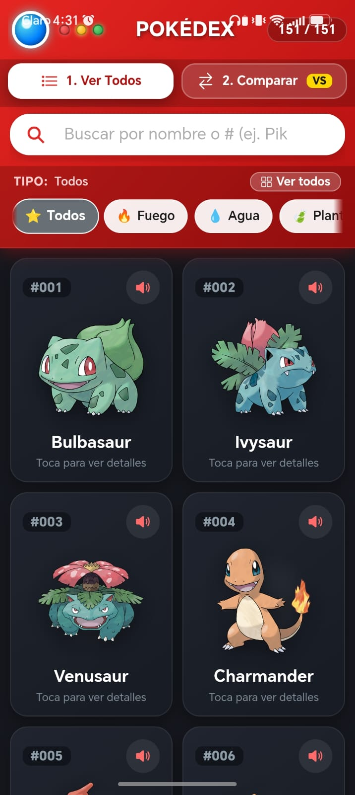
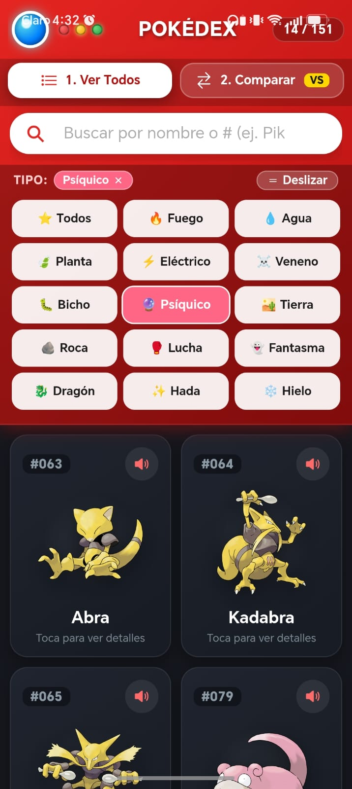
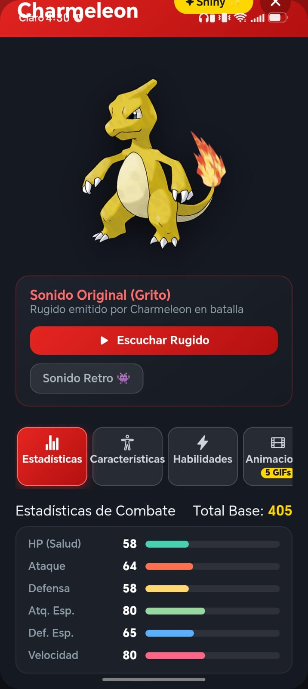
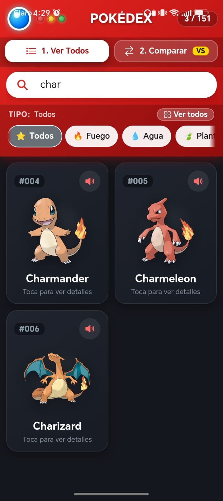
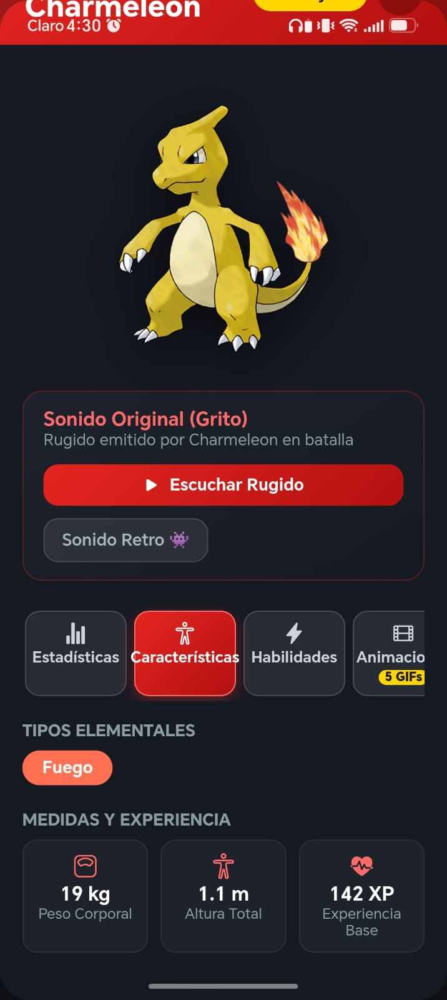
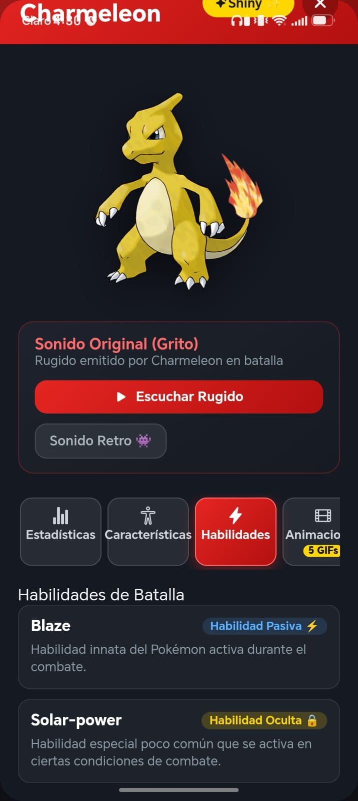
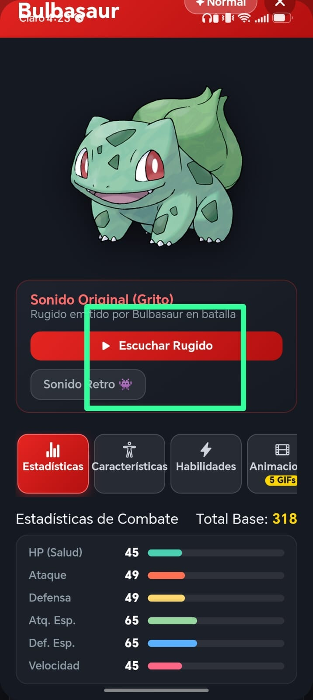
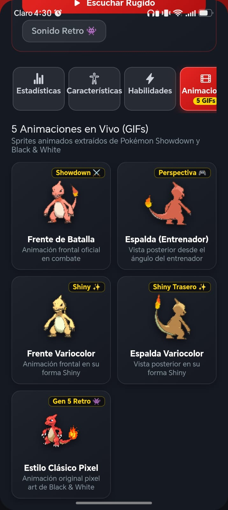
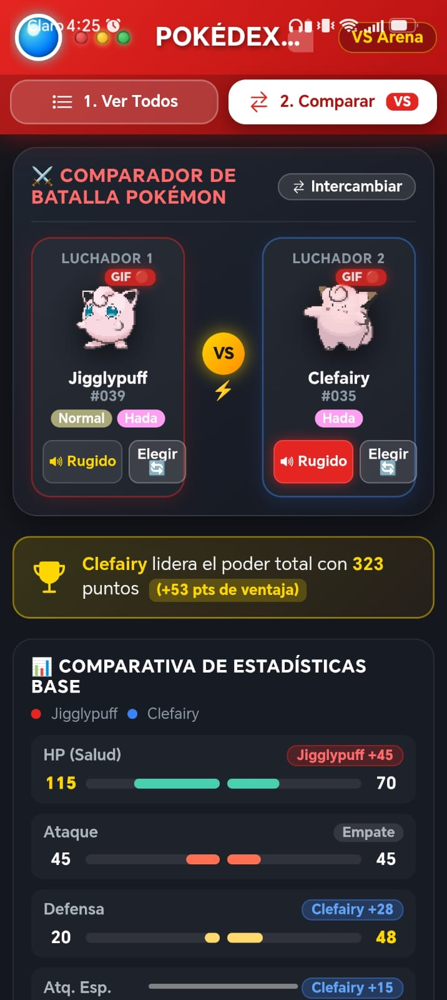

# Pokédex 2026 — Ionic + Angular

Aplicación móvil/web de una **Pokédex** (primera generación, 151 Pokémon) construida con **Ionic 9, Angular 22 y Capacitor 8**. Consume la [PokéAPI](https://pokeapi.co/) para mostrar información, sonidos y animaciones de cada Pokémon, y permite compararlos en una arena de combate.

---

## Contenido

- [Funcionalidades por nivel](#funcionalidades-por-nivel)
   - [Nivel 1 — Buscador y detalles](#nivel-1--buscador-y-detalles)
   - [Nivel 2 — Sonido, galería y GIF](#nivel-2--sonido-galería-y-gif)
   - [Nivel 3 — Comparar 2 personajes](#nivel-3--comparar-2-personajes)
- [Tecnologías](#tecnologías)
- [Estructura del proyecto](#estructura-del-proyecto)
- [Instalación y ejecución](#instalación-y-ejecución)
- [Ejecutar en Android](#ejecutar-en-android)
- [APIs y recursos utilizados](#apis-y-recursos-utilizados)
- [Autores](#autores)

---

## Funcionalidades por nivel

### Nivel 1 — Buscador y detalles

**Requisitos:** tener un buscador de personajes, mostrar sus detalles y ser agradable visualmente.

**Cómo se cumple:**

- **Buscador** por nombre o número (ej. `Pikachu`, `25`, `#025`) con `ion-searchbar`.
- **Filtro por tipo** (Fuego, Agua, Planta, Eléctrico, etc.) con chips deslizables o en cuadrícula.
- **Cuadrícula de tarjetas** con el artwork oficial de cada Pokémon.
- Al tocar una tarjeta se abre un **modal de detalles** con pestañas de información:
   - **Estadísticas:** HP, Ataque, Defensa, Atq. Esp., Def. Esp., Velocidad y total base.
   - **Características:** tipos, peso, altura y experiencia base.
   - **Habilidades:** habilidades pasivas y ocultas.
- Botón para alternar entre la versión **normal** y **Shiny**.
- Diseño inspirado en una Pokédex real: luces superiores, colores por tipo, barras de estadísticas animadas y estados de carga/vacío.

**Capturas:**

| Listado y buscador | Filtro por tipo | Detalle del Pokémon |
| :---: | :---: | :---: |
|  |  |  |

| Búsqueda por nombre | Pestaña Características | Pestaña Habilidades |
| :---: | :---: | :---: |
|  |  |  |

---

### Nivel 2 — Sonido, galería y GIF

**Requisitos:** reproducir un sonido del personaje, mostrar una galería de al menos 5 imágenes y permitir visualizar un GIF o WebP.

**Cómo se cumple:**

- **Sonido:** cada Pokémon tiene su **grito (cry)** en formato `.ogg`.
   - Se reproduce con el botón de la tarjeta, o automáticamente al abrir el detalle.
   - Botón **"Escuchar Rugido"** (sonido moderno) y **"Sonido Retro"** (estilo Game Boy).
   - Si el sonido moderno no está disponible, hace *fallback* automático al sonido clásico.
- **Galería de 5 imágenes animadas:** en la pestaña **Animaciones** del detalle se muestran 5 sprites:
   1. Frente de batalla
   2. Espalda (perspectiva del entrenador)
   3. Frente Shiny
   4. Espalda Shiny
   5. Estilo clásico pixel (Gen 5 Black & White)
- **Visualización de GIF:** todas las imágenes de la galería son **GIF animados**. Además, en el comparador cada luchador se muestra con su GIF en vivo.

**Capturas:**

| Reproducción de sonido | Sonido retro | Galería de 5 GIFs |
| :---: | :---: | :---: |
|  |  |  |

---

### Nivel 3 — Comparar 2 personajes

**Requisito:** permitir comparar 2 personajes.

**Cómo se cumple:**

- Pantalla **Comparar (VS Arena)** accesible desde la navegación principal.
- Selector de Pokémon en modal con buscador para elegir el **Luchador 1** y el **Luchador 2**.
- Botón **Intercambiar** para cambiar las posiciones.
- Cada luchador muestra su **GIF animado**, nombre, número, tipos y botón de **sonido**.
- **Comparativa detallada:**
   - Banner con el **ganador por poder total**.
   - **Barras duales enfrentadas** por cada estadística, con la ventaja resaltada.
   - Peso, altura y experiencia base lado a lado.
   - Habilidades de ambos Pokémon.

**Captura:**

<p align="center">
  
</p>

---

## Tecnologías

| Tecnología | Versión | Uso |
| --- | --- | --- |
| [Angular](https://angular.dev/) | 22 | Framework principal (componentes *standalone*) |
| [Ionic Framework](https://ionicframework.com/) | 9 | Componentes UI móviles |
| [Capacitor](https://capacitorjs.com/) | 8 | Empaquetado nativo (Android) |
| [RxJS](https://rxjs.dev/) | 7.8 | Manejo de peticiones HTTP |
| [Ionicons](https://ionic.io/ionicons) | 8 | Iconografía |
| TypeScript | 6 | Lenguaje |
| Vitest | 4 | Pruebas unitarias |

---

## Estructura del proyecto

```
pokemon-app/
├── src/
│   ├── app/
│   │   ├── pages/
│   │   │   ├── pokedex/        # Listado, buscador, filtros y modal de detalles
│   │   │   └── compare/        # Comparador de 2 Pokémon (VS Arena)
│   │   ├── services/
│   │   │   └── pokemon.ts      # Servicio con llamadas a la API, caché y helpers
│   │   ├── app.routes.ts       # Rutas (/pokedex, /compare)
│   │   └── app.component.*
│   ├── theme/variables.scss    # Tema de Ionic
│   └── global.scss
├── android/                    # Proyecto nativo de Capacitor
├── docs/screenshots/           # Capturas usadas en este README
├── capacitor.config.ts
└── package.json
```

---

## Instalación y ejecución

### Requisitos previos

- [Node.js](https://nodejs.org/) (versión LTS reciente)
- npm
- Ionic CLI (opcional): `npm install -g @ionic/cli`

### Pasos

```bash
# 1. Clonar el repositorio
git clone https://github.com/jossuer1/pokemon-app
cd pokemon-app

# 2. Instalar dependencias
npm install

# 3. Ejecutar en modo desarrollo
npm start
# o con Ionic CLI:
ionic serve
```

La aplicación estará disponible en `http://localhost:4200`.

### Otros comandos

```bash
npm run build   # Compilar para producción (genera la carpeta www/)
npm test        # Ejecutar pruebas unitarias
npm run lint    # Revisar el código con ESLint
```

---

## Ejecutar en Android

```bash
# 1. Compilar la app web
npm run build

# 2. Sincronizar con Capacitor
npx cap sync android

# 3. Abrir en Android Studio
npx cap open android
```

Desde Android Studio, selecciona un dispositivo o emulador y presiona **Run**.

---

## APIs y recursos utilizados

| Recurso | Uso |
| --- | --- |
| [PokéAPI](https://pokeapi.co/) | Lista, detalles y tipos de Pokémon |
| [PokeAPI/sprites](https://github.com/PokeAPI/sprites) | Artwork oficial y GIFs animados (Showdown y Gen 5) |
| [PokeAPI/cries](https://github.com/PokeAPI/cries) | Sonidos (gritos) de cada Pokémon |

> La app requiere **conexión a internet** para cargar datos, imágenes y sonidos.

---

## Autores

- **Josue Patiño**
- **Ariana Villota**

Estudiantes de Desarrollo de Software — ESFOT, Escuela Politécnica Nacional

---
